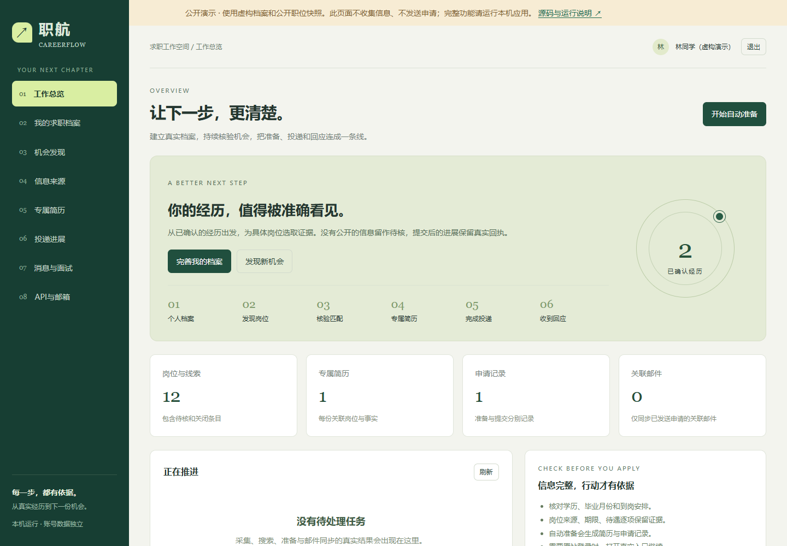

# 职航 CareerFlow

面向学生、应届生、在职与转岗求职者的本机求职工作空间。把个人事实、公开岗位、核验、匹配、简历、申请与回应连接起来。独立实现；不内置任何个人的学校、专业、届别或目标岗位。

**当前为0.1.1本机试运行版，不能宣称已完成各大招聘平台账号级全自动投递与站内消息验收。** 公开预览仅为只读样例。完整后端、API密钥、邮箱和定时任务运行在你自己的机器上。

[在线只读演示](https://yangwei251003.github.io/careerflow/) · [验收记录与缺口](docs/ACCEPTANCE.md)



## 已实现

- 独立账号与档案：学历、毕业日期、专业、经验、技能、语言、工作资格、意向和已确认经历。
- 公开职位读取：Greenhouse、Lever、Ashby、Workday公开招聘网页数据；企业官网/公告正文、JSON-LD与站内链接发现。
- 元宝搜索/Tavily自带密钥；按意向组合官网、公告及招聘网站检索词。搜索摘要先入待核线索，不直接当在招职位。
- 职位原文、日期、入口、薪资福利未知项、来源散列、快照、去重、完整列表移除判断；来源失败可见。
- 按届别、学历、经验、地点和证据进行保守匹配；语言、许可、证照及无法确定的细则提示复核。
- PDF / DOCX / TXT简历本机导入预览；选择保存后仍为待确认经历，不直接当已验证事实。
- 根据岗位选择已确认事实，输出DOCX、可提取文字PDF和TXT；多份简历ZIP下载、投递记录CSV导出。
- Ollama本地AI或兼容Chat Completions的云端模型，辅助选取经历、分析证据缺口和准备面试问题。
- 自动流程：检索与采集 → 条件判断 → 专属简历 → 申请记录；显式授权时，仅对官方邮箱已确认且无待核条件的岗位邮件发送。
- SMTP SSL/STARTTLS发送、IMAP关联邮件读取、自发测试邮件与回复关联；SMTP接受和企业回执分别记载。
- 原站申请入口、用户提交回执和面试/Offer记录；不把“打开链接”算成功投递。
- 持久队列、定时来源刷新、采集失败退避、只读网络请求有限重试；发送未知结果不盲目重试。
- 账号隔离、密码哈希、密钥加密、来源限制和基础CSRF/SSRF防护。

## 快速运行

Python 3.11+，推荐3.12。程序运行只需要Python；Node仅用于浏览器验收。

需要复现本次验收依赖时，使用`requirements-tested.lock`；该文件来自独立Python 3.12环境，包含测试依赖，普通运行可使用下面的`requirements.txt`。

```sh
python -m venv .venv
# Windows
.venv\Scripts\python -m pip install -r requirements.txt
.venv\Scripts\python -m uvicorn careerflow.app:app --host 127.0.0.1 --port 8769
# macOS / Linux
.venv/bin/pip install -r requirements.txt
.venv/bin/python -m uvicorn careerflow.app:app --host 127.0.0.1 --port 8769
```

打开 http://127.0.0.1:8769 ，创建自己的本机账号。Windows安装好依赖后，可双击“启动职航.cmd”；停止入口保留数据。服务关闭时不运行定时任务，电脑关机也不会自动执行。

1. 填写求职档案，并确认真实经历与个人职责。
2. 在“信息来源”接入官网或公开职位源，点击采集；根据需要启用定时。
3. 在“API与邮箱”选择本地AI或填写自己的云端模型密钥，并测试连接；[本地部署说明](docs/LOCAL_AI.md)。官网公开源采集不需要搜索密钥，没有模型也可按确认事实生成简历。
4. 检查岗位原文、条件与真实投递入口，再生成简历。
5. 通过原站登录提交并记回执，或核对招聘邮箱后授权邮件投递。
6. 配置IMAP后同步关联回信，准备对应面试。

## 邮件真实验收

先使用自己的测试邮箱。填写加密SMTP端口465或587、IMAP端口993及应用授权码；点击“向自己发送测试邮件”。这一步只发到配置的同一邮箱，不发给企业。

点击同步后，界面分别显示“发送服务器接受”“已收到原测试邮件”“已收到测试回复”。收到原邮件后回复它，再同步；只有实际IMAP读到关联邮件才会更新。没有凭据、发送失败或尚无回复都不会造出成功状态。

## 接入边界

| 渠道 | 本版真实实现 | 尚未实现/验收 |
|---|---|---|
| Greenhouse / Lever / Ashby | 公开职位接口、原站入口 | 招聘方授权的提交API，不等同求职者通用权限 |
| Workday | 公开招聘网页数据读取 | 不是保证长期稳定的官方开放求职API；原站登录申请仍需用户 |
| 企业官网 / 公告 | 限定范围正文、JSON-LD、站内链接 | 不能宣称抓完所有企业完整官网；动态登录页可能只能留下线索 |
| BOSS / 智联 / 51job / 猎聘 | 搜索发现与链接导入，真实原站入口 | 账号级自动采集、聊天、附件投递、站内回复监听未接通 |
| 邮件 | SMTP发送、IMAP精确关联、人工回执；QQ自发与回复链路已实测 | 其他邮件商分别验收；自发测试不等同招聘企业已收到或录用 |
| 模型/搜索API | Ollama本地模型无密钥；云端模型和搜索支持自带密钥 | 每家服务商、模型、额度与兼容性分别测试；本地模型不替代实时职位来源 |

本版不绕过登录、验证码或访问限制；“接口已写”不等于“取得了平台合作权限”。BossHi是企业协作开发体系，不能被当成BOSS求职端开放数据接口。参考与依据见 [范围与官方来源](docs/SCOPE.md)。

## 测试与可追溯性

```sh
.venv\Scripts\python -m pip install -r requirements-dev.txt
.venv\Scripts\python -m pytest -q tests
npm ci
# Windows浏览器验收默认用已安装Edge；其他系统先 npx playwright install chromium
npm run test:browser
```

浏览器验收自动注册明确标注为虚构的测试档案，读真实公开职位、生成简历并停在材料准备；不向企业发送虚构申请。`scripts/live_acceptance.py`用于更广的公开源验收，结果保存在`qa/private/`，不提交Git。

当前实测与缺口见 [验收报告](docs/ACCEPTANCE.md)。模拟SMTP/IMAP测试与真实邮箱测试分开记录。

## 数据、源码与部署

- `careerflow/` 后端、`web/` 前端、`tests/`测试、`docs/`设计与验收、`scripts/`维护入口。
- `data/`含数据库、加密凭据、加密密钥、简历与日志。备份需包含整个目录，保护并限制访问。Git默认排除全部运行数据。
- 通过`CAREERFLOW_DATA`可指定独立数据目录；默认只监听本机。一个数据目录只运行一个带调度器的服务进程。
- `site/`是独立的只读公开演示，使用虚构档案与有限公开职位快照；不会上传用户简历或API设置。
- 当前尚未验收面向公众运营的多节点并发、SMTP域名信誉、邮箱OAuth、账号找回、配额计费、灾难恢复、完整渗透与压力测试。公网生产部署前应完成独立验收；不能把Pages预览称为云端完整服务。

## 许可与参考

本项目原创代码使用MIT许可。依赖各自保留原许可；职位正文属于原发布者，仅供本机求职核验，不随源码成批公开。

[BossHunter](https://github.com/shengjidaguai-china/BossHunter)用于研究工作流、能力划分和验收边界，其许可为PolyForm Noncommercial 1.0.0。本项目没有复制其实现或将其改许可证发布。

## 变更记录

- 0.1.1（2026-11-11）：本地AI接入、简历导入预览、简历ZIP与投递CSV导出；修复QQ改写Message-ID后的关联，真实测试邮箱收发及回复已验证。

- 0.1.0（2026-11-11）：通用档案、多源公开职位、核验匹配、事实简历、投递状态、API设置、定时任务及邮件链路首版。真实招聘平台账号级自动化仍列为未验收。
